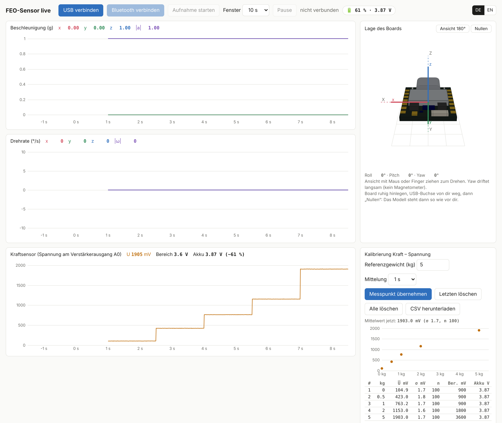

# FEO sensor – heel offloading orthosis (XIAO nRF54L15 Sense)

[](LICENSE)
[](https://wiki.seeedstudio.com/xiao_nrf54l15_sense_getting_started/)
[](https://platformio.org)

Sensor firmware and browser app for a heel offloading orthosis ("Fersenentlastungsorthese", FEO). Based on [XIAO_IMU_Live](https://github.com/soylentOrange/XIAO_IMU_Live). The **Seeed Studio XIAO nRF54L15 Sense** samples at 100 Hz:

- the 6-axis IMU (LSM6DS3TR-C),
- the output voltage of a force sensor (FSR) amplifier at A0, with automatic ADC range switching,
- the battery voltage (once per second).

The web app shows everything live via **Bluetooth LE** or **USB serial**, records CSV, and has a **force–voltage calibration** panel (reference weight per point, averaged voltage, CSV export).

**Web app:** <https://soylentorange.github.io/FEO_Sensor/> (Chrome or Edge on desktop and Android, installable as an app; published by the release workflow, see [Firmware Updates](#firmware-updates-over-bluetooth-ota)). `docs/index.html` also works opened from disk.

<p align="center">
  
</p>

---

## Table of Contents

1. [Overview](#overview)
2. [Hardware](#hardware)
3. [Firmware](#firmware)
   - [Building and Flashing](#building-and-flashing)
   - [Data Formats](#data-formats)
4. [Web App](#web-app)
   - [Features](#features)
   - [Force Calibration](#force-calibration)
   - [Browser Support](#browser-support)
   - [Install on Android](#install-on-android)
5. [Repository Layout](#repository-layout)
6. [Acknowledgements & Funding](#acknowledgements--funding)
7. [License](#license)

---

## Overview

- **Sensor:** LSM6DS3TR-C on the XIAO nRF54L15 Sense (I²C, Zephyr driver `lsm6dsl`), ±16 g and ±2000 °/s, internal rate 208 Hz, output 100 Hz.
- **Force sensor:** 30 mm FSR in a transimpedance amplifier (MCP602, V_ref ≈ 0.1 V) with a Sallen-Key low-pass (~23 Hz), output to A0. The SAADC switches its gain automatically (see below).
- **Battery:** LiPo, measured via the on-board 1:2 divider at AIN7. The divider is switched on only for the measurement.
- **Firmware:** Zephyr 4.2 via PlatformIO. Streams every sample over USB serial (CSV) and over BLE notifications at the same time.
- **Web app:** a single HTML file without external dependencies. Uses Web Bluetooth and Web Serial, a Madgwick filter for orientation, and a small 3D model derived from the Seeed STEP model.

## Hardware

| XIAO pin | nRF54L15 | Use |
|---|---|---|
| D1 | P1.05 | Supply of the MCP602 (driven high by the firmware) |
| A0 / D0 | P1.04 (AIN0) | Amplifier output (U_FSR) |
| – | P1.14 (AIN7) | Battery voltage / 2 (on-board divider) |
| – | P1.15 | Switch for the battery divider (`vbat_pwr`, on-board) |

The pins are set in [`zephyr/app.overlay`](zephyr/app.overlay).

**ADC range switching (FSR channel).** Internal reference 0.9 V, 12 bit, 8× oversampling. The first sample after a switch is discarded (the switch and the repeated sample happen within the same 10 ms period).

| Range | SAADC gain | Full scale | Switch up above | Switch down below |
|---|---|---|---|---|
| 0 | 1 | 0.9 V | 800 mV | – |
| 1 | 1/2 | 1.8 V | 1600 mV | 350 mV |
| 2 | 1/4 | 3.6 V | – | 700 mV |

Voltages are reported in mV at the pin, including the ~0.1 V reference offset of the amplifier. The battery is measured with gain 1/4 and multiplied by 2.

## Firmware

### Firmware Updates over Bluetooth (OTA)

Release builds contain the **MCUboot** bootloader and an **MCUmgr/SMP** service, so new firmware can be installed from the web app without a cable.

1. **Once, via USB:** flash `feo_sensor_vX.Y.Z_factory.hex` (MCUboot + firmware) from a [release](../../releases), e.g.
   ```bash
   pyocd flash -t nrf54l feo_sensor_v1.0.0_factory.hex
   ```
   (pyOCD comes with PlatformIO: `~/.platformio/penv/bin/pyocd`; `pip install pyocd` also works.)
2. **Later updates:** connect the web app via Bluetooth. The *Firmware update* card shows the installed version. Choose `feo_sensor_vX.Y.Z_update.bin` from the release (or press *Install latest version* when the app is served via GitHub Pages, see below). The app uploads the image, the board restarts, MCUboot swaps the images, and the new firmware confirms itself once IMU, ADC and Bluetooth are running. If it does not get that far, MCUboot restores the previous version on the next reset.

**Making a release:** push a tag, e.g. `git tag v1.0.0 && git push origin v1.0.0`. The workflow [`.github/workflows/release.yml`](.github/workflows/release.yml) builds with Zephyr 4.4.2 and sysbuild ([`west.yml`](west.yml), [`zephyr/sysbuild.conf`](zephyr/sysbuild.conf), [`zephyr/ota.conf`](zephyr/ota.conf)) and attaches both files to the release. *Run workflow* without a tag only builds (artifacts).

**Automatic download in the app:** browsers cannot download release assets directly (no CORS). Therefore each release also publishes the web app together with `fw/latest.json` and the update file on GitHub Pages, and the app offers *Install latest version*. The workflow [`pages.yml`](.github/workflows/pages.yml) also redeploys when `docs/` changes on `main`. One-time setup: *Settings → Pages → Source: GitHub Actions*, and *Settings → Secrets and variables → Actions → Variables*: `DEPLOY_PAGES` = `true`.

#### Signing Key

MCUboot only installs update images that are signed with the key its bootloader was built with.

- **Using the official releases** of this repository (`_factory.hex` + `_update.bin`): you do not need a key. Your board then only accepts updates signed by the maintainer of this repository.
- **Building yourself or using a fork:** create your own key and store it as the Actions secret `MCUBOOT_SIGNING_KEY` in your fork (*Settings → Secrets and variables → Actions → Secrets*):
  ```bash
  pip install imgtool
  imgtool keygen -k feo_key.pem -t ecdsa-p256
  ```
  Paste the whole content of `feo_key.pem` into the secret and keep the file safe offline. **Never commit the private key** (`*.pem` is in `.gitignore`).

> [!WARNING]
> Without the secret, the workflow signs with MCUboot's **publicly known test key**: anyone within Bluetooth range could then install firmware on the board. Fine for a bench prototype, not for use on patients.
>
> A board only accepts updates signed with the key of the `_factory.hex` it was flashed with. After changing the key (or switching between official releases and your own builds), flash the matching `_factory.hex` via USB once.

The PlatformIO build below has no bootloader and no OTA. Flashing it overwrites MCUboot; flash a `_factory.hex` again to get OTA back.

### Building and Flashing

Requirements: [PlatformIO](https://platformio.org) (e.g. the VS Code extension). The Seeed platform is fetched automatically.

```bash
pio run -t upload        # build and flash via the on-board CMSIS-DAP probe
pio device monitor       # optional: show the CSV stream (115200 baud)
```

Settings such as sample rate and ranges are at the top of [`src/main.c`](src/main.c):

| Constant | Default | Meaning |
|---|---|---|
| `SAMPLE_RATE_HZ` | 100 | Output rate |
| `IMU_ODR_HZ` | 208 | Internal sensor rate |
| `ACCEL_RANGE_G` | 16 | ±2, 4, 8 or 16 g |
| `GYRO_RANGE_DPS` | 2000 | ±245, 500, 1000 or 2000 °/s |
| `BLE_BATCH` | 5 | Samples per BLE notification (20 packets/s) |
| `SERIAL_BATCH` | 2 | Lines per serial burst (see below) |
| `BAT_PERIOD` | 100 | Battery measurement every 100 samples (1 s) |
| `BAT_DIVIDER` | 2 | On-board battery divider |

Range thresholds are in `fsr_up_mv` / `fsr_down_mv` in `src/main.c`.

The LED blinks slowly while advertising and fast while a BLE client is connected.

> [!NOTE]
> The USB-serial bridge on the XIAO only forwards data immediately when the line is idle for more than about 10 ms. A steady 100 lines/s would otherwise be buffered in 16 KiB blocks (about 4 s delay). The firmware therefore sends two lines every 20 ms.

### Data Formats

**USB serial** (115200 baud), one line per sample; lines starting with `#` are comments:

```text
t_ms,ax_g,ay_g,az_g,gx_dps,gy_dps,gz_dps,u_fsr_mv,fsr_range_mv,u_bat_mv
123450,0.012,-0.004,1.001,0.3,-0.1,0.0,412,900,3874
```

`fsr_range_mv` is the full scale the FSR sample was taken with (900, 1800 or 3600). `u_bat_mv` is the last battery reading (0 until the first measurement).

**Bluetooth LE:** device name `XIAO-FEO`

- Service `7a1e0011-5c3b-4f0a-9d2e-3c8f1b6a4d01`
- Characteristic `7a1e0012-5c3b-4f0a-9d2e-3c8f1b6a4d01` (notify): samples
- Characteristic `7a1e0013-5c3b-4f0a-9d2e-3c8f1b6a4d01` (read, notify once per second): battery voltage, uint16 in mV

The UUIDs differ from XIAO_IMU_Live, so the two apps do not pick up each other's boards.

Each sample notification (little endian):

| Field | Type | Content |
|---|---|---|
| `t_ms` | uint32 | Timestamp of the first sample in the packet |
| `n` | uint8 | Number of samples, 10 ms apart |
| samples | n × 14 bytes | 6 × int16: ax, ay, az in mg; gx, gy, gz in 0.1 °/s<br>uint16: bits 0–13 U_FSR in mV, bits 14–15 range (0 = 0.9 V, 1 = 1.8 V, 2 = 3.6 V) |

**CSV recordings** from the web app use the serial columns plus `ref_kg`, the reference weight entered in the calibration panel at that moment (empty if none).

## Web App

The app lives in [`docs/index.html`](docs/index.html). It can be opened directly from disk (USB and BLE work in Chrome/Edge on desktop) or served via GitHub Pages.

### Features

- Connect via **Bluetooth LE** or **USB serial**
- Live plots of acceleration and angular rate including the magnitudes |a| and |ω|, window 5 / 10 / 30 s
- **3D orientation** view (Madgwick filter, accelerometer + gyroscope) with a model of the board, drag with mouse or finger to rotate the camera, "Zero" to reset orientation and gyro offset
- **Force sensor** voltage plot with current range, **battery voltage** with a rough charge estimate (LiPo, only meaningful without USB charging)
- **CSV recording** and download (including U_FSR, range, U_bat and the entered reference weight)
- **Force–voltage calibration** points with CSV export
- **Battery** level badge in the header (percentage estimate and voltage)
- **Firmware update** over Bluetooth (MCUmgr/SMP)
- German and English (switch in the top right corner)
- Works offline after the first visit and can be installed as an app (PWA)

Yaw drifts slowly because the board has no magnetometer.

### Force Calibration

1. Connect, put a known weight on the sensor, keep it still.
2. Enter the weight in kg under **Reference weight** and press **Add point**. The app stores the mean, standard deviation, min, max and number of FSR samples over the averaging window (0.5–3 s), the range(s) used and the battery voltage.
3. Repeat for all weights, then **Download CSV**:

```text
nr,time_iso,ref_kg,u_fsr_mean_mv,u_fsr_sd_mv,u_fsr_min_mv,u_fsr_max_mv,n,avg_s,fsr_range_mv,u_bat_mv
1,2026-11-22T11:20:54.124Z,0.5,423.0,1.7,420,426,100,1,900,3870
```

Points are kept in the browser (localStorage) until deleted. For loading/unloading curves (hysteresis), use a normal recording instead: every row then carries the currently entered reference weight.

### Browser Support

| | Bluetooth LE | USB serial |
|---|---|---|
| Chrome / Edge on macOS, Windows, Linux | yes | yes |
| Chrome on Android | yes | no |
| Brave | after enabling `brave://flags/#brave-web-bluetooth-api` | yes |
| Safari, Firefox, iOS | no | no |

Web Bluetooth and Web Serial need a secure context: `https://` (e.g. GitHub Pages), `localhost`, or a file opened from disk.

### Install on Android

1. Open the [web app](https://soylentorange.github.io/FEO_Sensor/) in Chrome.
2. Menu ⋮ → **Add to Home screen** → **Install**.
3. Start "FEO live" from the home screen, tap **Connect Bluetooth** and choose `XIAO-FEO`. Android asks for the "Nearby devices" permission the first time.

## Repository Layout

```text
platformio.ini          PlatformIO project (board seeed-xiao-nrf54l15, Zephyr)
src/main.c              Firmware: IMU, FSR and battery readout, serial CSV, BLE GATT service
zephyr/prj.conf         Zephyr configuration (I²C, sensor, ADC, BLE)
zephyr/app.overlay      Pins: D1 amplifier supply, A0 FSR, AIN7 battery
zephyr/sysbuild.conf    MCUboot for the release build
zephyr/ota.conf         MCUmgr/SMP over BLE (release build only)
west.yml                Zephyr version for the release build
.github/workflows/      release.yml: firmware release (factory hex + OTA update); pages.yml: web app + latest update on Pages
zephyr/CMakeLists.txt
docs/index.html         Web app (single file)
docs/manifest.webmanifest, docs/sw.js, docs/icons/   PWA files
docs/assets/            Logos and screenshot
```

---

## Acknowledgements & Funding

This project has received funding from the European Union's Horizon Europe research and innovation programme under grant agreement No. **101136376** ([**SmILE** – *Smart Implants for Life Enrichment*](https://horizon-smile.eu/)).

<p align="left">
  <a href="https://horizon-smile.eu/">
    
  </a>
  &nbsp;&nbsp;&nbsp;&nbsp;
  <a href="https://commission.europa.eu">
    
  </a>
</p>

* **Project Website:** [https://horizon-smile.eu/](https://horizon-smile.eu/)

*Disclaimer:* Funded by the European Union. Views and opinions expressed are however those of the author(s) only and do not necessarily reflect those of the European Union or the European Health and Digital Executive Agency (HADEA). Neither the European Union nor the granting authority can be held responsible for them.

The simplified 3D board model is derived from the Seeed Studio XIAO nRF54L15 STEP model ([GrabCAD](https://grabcad.com/library/seeed-studio-xiao-nrf54l15-sense-1)).

---

## License

This project is licensed under the **MIT License** ([MIT](LICENSE)).
For details, please refer to the [LICENSE](LICENSE) file.
