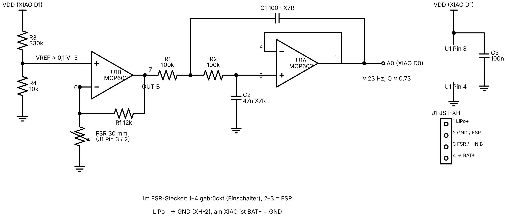
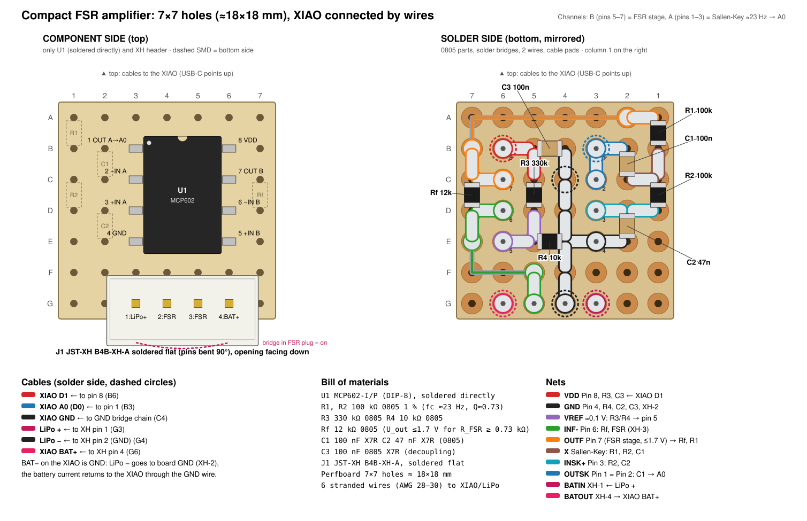
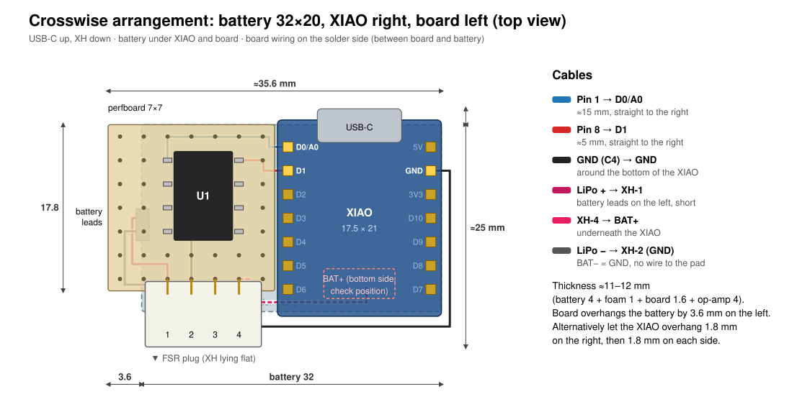
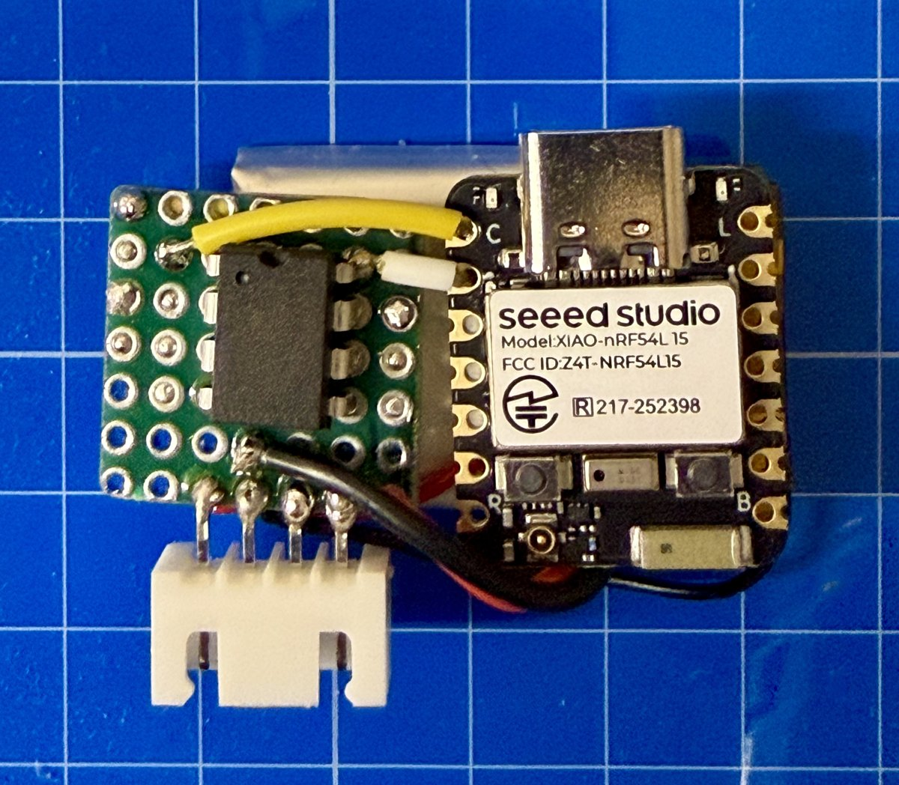

# Hardware – FSR amplifier on perfboard

Analog front end for the 30 mm FSR: a non-inverting stage with V_ref ≈ 0.1 V, followed by a unity-gain Sallen-Key low-pass (≈ 23 Hz, Q ≈ 0.73). Its output goes to A0 of the XIAO nRF54L15 Sense. The op-amp (MCP602) is powered from GPIO D1, so it only draws current while the firmware drives D1 high.

The perfboard is a separate 7 × 7 hole board (≈ 18 × 18 mm). It is connected to the XIAO with wires only. The 4-pin JST-XH connector carries the FSR (middle pins) and also acts as the power switch: its outer pins are in series with the LiPo plus lead, and the FSR plug bridges them.

Drawings are labelled in German. The scripts in [`tools/`](tools) regenerate them; `perfboard_layout.py` also checks the wiring against the netlist.

## Schematic



([SVG](schematic.svg))

| Stage | Op-amp half | Pins | Function |
|---|---|---|---|
| FSR amplifier | U1B | 5 (+IN), 6 (−IN), 7 (OUT) | U_out = V_ref · (1 + Rf / R_FSR), V_ref = 3.3 V · 10k / 340k ≈ 0.097 V |
| Low-pass | U1A | 3 (+IN), 2 (−IN = OUT), 1 (OUT) | Sallen-Key, R1 = R2 = 100k, C1 = 100n, C2 = 47n → f_c ≈ 23 Hz |

Note: compared with the first plan, the two op-amp halves are swapped (FSR stage on B, filter on A). This makes the perfboard layout possible without top-side jumpers. Electrically nothing changes.

**Choosing Rf.** The output must stay below 1.7 V, because the MCP602 input common-mode range ends at VDD − 1.2 V = 2.1 V (the Sallen-Key stage is a follower). With Rf = 12k the limit is reached at R_FSR = Rf / (1.7 V / V_ref − 1) ≈ 0.73 kΩ. Increase Rf if the FSR never gets that low under the maximum load, so that small loads get more resolution.

## Bill of materials

See [`bom.csv`](bom.csv). All resistors and capacitors are 0805 and come from E12 sets.

| Ref | Value | Package |
|---|---|---|
| U1 | MCP602-I/P | DIP-8, soldered directly |
| R1, R2 | 100 kΩ 1 % | 0805 |
| R3 | 330 kΩ 1 % | 0805 |
| R4 | 10 kΩ 1 % | 0805 |
| Rf | 12 kΩ 1 % | 0805 |
| C1, C3 | 100 nF X7R | 0805 |
| C2 | 47 nF X7R | 0805 |
| J1 | JST-XH B4B-XH-A (4-pin) | soldered lying flat, opening downwards |
| – | Perfboard 7 × 7 holes, 2.54 mm | ≈ 17.8 × 17.8 mm |

## Perfboard layout



- Component side: only U1 (no socket) and J1.
- Solder side: all 0805 parts, placed across two neighbouring pads, plus solder bridges and two short bare wires. The two hole columns under U1 carry the V_ref divider, R4 and the decoupling capacitor C3.
- The solder side is drawn mirrored, as you see it while soldering (column 1 on the right).

## Wiring

All wires are soldered on the solder side. Coordinates are row letter + column number from the layout.

| From (perfboard) | To | Signal |
|---|---|---|
| U1 pin 1 (B3) | XIAO **D0 / A0** (left row, 1st pad next to USB-C) | Filter output |
| U1 pin 8 (B6) | XIAO **D1** (left row, 2nd pad) | Op-amp supply |
| GND bridge chain (C4) | XIAO **GND** (right row, 2nd pad, between 5V and 3V3) | Ground |
| J1 pin 4 (G6) | XIAO **BAT+** pad (bottom side) | Switched battery plus |
| J1 pin 1 (G3) | LiPo + | Battery plus (unswitched) |
| J1 pin 2 (G4) | LiPo − | Battery minus (BAT− on the XIAO is GND) |

J1 / FSR plug: pins 1 and 4 bridged inside the plug, FSR between pins 2 and 3. Without the FSR plugged in, the XIAO is disconnected from the battery; the battery is then also not charged via USB.

Pin 2 (GND) of J1 sits next to pin 1 (unswitched LiPo +). Solder carefully and use a LiPo with a protection circuit.

## Mechanical arrangement



- LiPo 32 × 20 × 4 mm lying crosswise, XIAO on the right part of the battery with USB-C at the top, perfboard on the left part with J1 at the bottom.
- Perfboard with the solder side towards the battery, insulated with 1 mm double-sided foam tape. The wires run in that layer.
- Overall ≈ 36 × 25 mm, ≈ 11–12 mm thick. The perfboard overhangs the battery by ≈ 3.6 mm on the left (or let the XIAO overhang 1.8 mm on the right).
- Solder the BAT+ wire to the XIAO before mounting it on the battery.

## Assembled prototype

<p align="center">
  
</p>

Perfboard (left) with the MCP602 and the flat-mounted JST-XH connector, XIAO nRF54L15 Sense (right), both on the crosswise LiPo. Yellow: A0, white: D1.

## Regenerating the drawings

```
python3 tools/perfboard_layout.py perfboard_layout.svg   # also checks the netlist
python3 tools/arrangement.py arrangement.svg
pip install schemdraw && python3 tools/schematic.py schematic.svg
```
